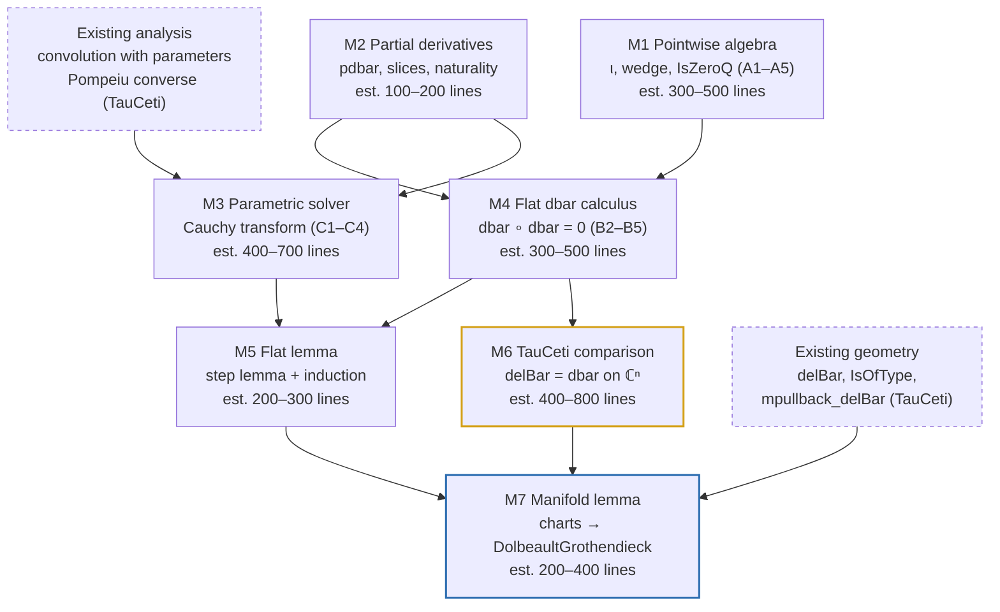

# Blueprint: Formalising the Dolbeault–Grothendieck Lemma in Lean 4

*As of 2026-10-30*

## Overview

The plan proves the lemma first on open subsets of ℂⁿ by Grothendieck's induction, then transfers it to X through holomorphic charts. The analytic core reduces to one parametric Cauchy transform, built from TauCeti's Cauchy–Pompeiu file and Mathlib's parametric convolution lemmas.

**Target.** For every open U ⊆ X, q ∈ ℕ, x ∈ U and ω ∈ Γ(U, 𝒜^{0,q+1}) with ∂̄ω = 0, there are an open U′ with x ∈ U′ ⊆ U and η ∈ Γ(U′, 𝒜^{0,q}) with ∂̄η = ω|U′.

**Four layers.**

1. *Parametric ∂̄-solver in one variable* (pure analysis, Banach-valued). Solves ∂g/∂z̄_k = f near x, keeps g holomorphic in every variable in which f is, and commutes with continuous linear maps.
2. *Flat Dolbeault complex on ℂⁿ*. Forms are maps into Mathlib's `ℂⁿ [⋀^Fin q]→L[ℝ] ℂ`; ∂̄ω = Σ_j dz̄_j ∧ ∂̄_j ω. Contains the induction and the flat lemma.
3. *Comparison with TauCeti*. Identifies TauCeti's `delBar` on open subsets of ℂⁿ with the flat ∂̄.
4. *Transfer to X* through charts and `mpullback_delBar`, then instantiates `DolbeaultGrothendieck E X`.

**Two simplifications drive the design.** The statement is local, so each induction step may shrink the neighbourhood; Hörmander's exhaustion argument for a whole polydisc is not needed. The sup norm on `Fin n → ℂ` makes `Metric.ball x r` a polydisc, so no polydisc API is needed.

**Upstream route.** TauCeti's roadmap ComplexKahlerGeometry, stage K2, lists `dolbeault-grothendieck-lemma` as a target. As of 2026-10-29 K2 still needs local exactness and the parameter-dependent solver ([#22585](https://github.com/TauCetiProject/TauCeti/pull/22585)). Layers 1–3 map onto exactly these items; layer 4 is your project's glue.

## Existing infrastructure

About two thirds of the analysis exists; the gaps are flat form algebra, the parametric solver and the TauCeti comparison. Names marked *verify* come from documentation, not from compiling against a pin.

| Declaration | Library / file | Role here |
| --- | --- | --- |
| `HasCompactSupport.fderiv_two_pi_inv_smul_integral_sub_inv_smul` | TauCeti `Analysis/Complex/Pompeiu.lean` ([#13584](https://github.com/TauCetiProject/TauCeti/pull/13584)) | D(Tf) = f for compactly supported C¹ f : ℂ → F; gives ∂̄_k g = f on slices |
| `HasCompactSupport.hasFDerivAt_integral_sub_inv_smul` | same | derivative of the Cauchy transform; fallback for slice smoothness |
| `Complex.locallyIntegrable_inv` | TauCeti `MeasureTheory/Integral/NormRpow.lean` | local integrability of the kernel t ↦ t⁻¹ |
| `MeasureTheory.contDiffOn_convolution_right_with_param(_comp)` | Mathlib `Analysis/Calculus/ContDiff/Convolution` ([docs](https://florisvandoorn.com/carleson/docs/Mathlib/Analysis/Calculus/ContDiff/Convolution.html)) | joint smoothness of the solver in all variables |
| `MeasureTheory.hasFDerivAt_convolution_right_with_param` | same | moving ∂̄_j (j ≠ k) under the integral |
| `ContDiffBump` | Mathlib `Analysis/Calculus/BumpFunction` | cutoff χ = 1 on ball(x_k, R), support in closedBall(x_k, 3R/2) |
| `ContinuousLinearMap.integral_comp_comm` | Mathlib | solver commutes with continuous linear maps |
| `extDeriv`, `ContinuousAlternatingMap.alternatizeUncurryFin` (*verify*) | Mathlib `Analysis/Calculus/DifferentialForm/Basic` | carrier `E → E [⋀^Fin k]→L[ℝ] F`; wedge with a 1-form |
| symmetric second derivative, e.g. `ContDiffAt.isSymmSndFDerivAt` (*verify*) | Mathlib `Analysis/Calculus/FDeriv/Symmetric` | ∂̄_i∂̄_j = ∂̄_j∂̄_i, hence ∂̄² = 0 |
| `SmoothAlmostComplexStructure.delBar`, `IsOfType`, `typeProjection_delBar` | TauCeti `Geometry/Manifold/DifferentialForm/Dolbeault/Basic.lean` ([#22188](https://github.com/TauCetiProject/TauCeti/pull/22188)) | upstream ∂̄ on `SmoothForm I M F k` |
| `mpullback_delBar` | same | ∂̄ commutes with pullback along pseudoholomorphic maps; chart transfer |
| `delBar_wedgeWith` (open PR) | TauCeti `Dolbeault/Leibniz.lean` ([#22585](https://github.com/TauCetiProject/TauCeti/pull/22585)) | not needed for the core |

**Gaps to fill.**

- Interior product `ι_v` on `ContinuousAlternatingMap` and its identity with wedge by a 1-form. Check Mathlib for `curryLeft`; otherwise about 40 lines.
- The parametric solver and its four properties (layer 1).
- Flat ∂̄, its coordinate calculus, and ∂̄² = 0 in all degrees on ℂⁿ (layer 2). TauCeti's ∂̄² = 0 is so far only proved on functions.
- Identification of TauCeti `SmoothForm` on an open subset of ℂⁿ with flat forms, and of `delBar` with flat ∂̄ (layer 3).

## Design decisions

**D1. Carrier: alternating-map valued functions, no coefficients.** A flat (0,q)-form is `ω : (Fin n → ℂ) → Form q`, where `Form q := (Fin n → ℂ) [⋀^Fin q]→L[ℝ] ℂ`. This is Mathlib's `extDeriv` carrier and the fibre of TauCeti's `SmoothForm`. `Form q` is a complex Banach space, so the one-variable solver applies to ω directly. No coefficient extraction, no multi-index signs, no `Finset` bookkeeping.

**D2. Type (0,q) is a pointwise predicate.** `IsZeroQ a :⇔ ∀ i v, a (update v i (I • v i)) = -I • a v`: conjugate-linear in each slot. It is the kernel of a family of continuous ℂ-linear maps, so it passes through integrals and derivatives.

**D3. Flat ∂̄ is defined by its coordinate formula.** `dbar ω z := ∑ j, wedge (dzbar j) (pdbar j ω z)`. Agreement with the (0,q+1) part of `extDeriv` is a separate lemma in layer 3. This keeps layers 1–2 independent of TauCeti internals, so they survive TauCeti refactors.

**D4. "Involves only dz̄_0, …, dz̄_{k−1}" is stated by contractions.** `InvolvesOnly k a :⇔ ∀ j, k ≤ j → ι (e j) a = 0`, with `e j := Pi.single j 1`. Lean indices are 0-based; the maths below is 1-based.

**D5. The solver is an explicit `def`, not an existential.** Naturality `L (solve f z) = solve (L ∘ f) z` then holds by `integral_comp_comm`. Every invariant subspace (type, `InvolvesOnly`) is a family of kernels, so the solution inherits it.

**D6. Conventions.** TauCeti's Pompeiu file uses D u = u′(z)·1 + I·u′(z)·I = 2∂̄u and T f = (2π)⁻¹∫(w−z)⁻¹ f(z) dz. We set ∂̄_j f := ½·D_j f and solve with 2T, that is π⁻¹∫(w−z)⁻¹ f(z) dz. Smoothness is `ContDiffOn ℝ ∞`; check whether your pin writes ∞ as `⊤` or uses `WithTop ℕ∞`.

**D7. Proposed file layout (TauCeti naming).**

| File | Contents | Layer |
| --- | --- | --- |
| `TauCeti/Analysis/Complex/PompeiuParam.lean` | slice lemma, `cauchySolve`, its smoothness, ∂̄_k, ∂̄_j, naturality | 1 |
| `TauCeti/Analysis/Complex/DbarFlat/Algebra.lean` | `dzbar`, `ι`, `wedge`, contraction identities, `IsZeroQ`, expansion in contractions | 2 |
| `TauCeti/Analysis/Complex/DbarFlat/Basic.lean` | `pdbar`, `dbar`, naturality, ∂̄² = 0, `ι` of `dbar` | 2 |
| `TauCeti/Analysis/Complex/DbarFlat/Grothendieck.lean` | step lemma, induction, `exists_dbar_eq` | 2 |
| `TauCeti/Geometry/Manifold/DifferentialForm/Dolbeault/Flat.lean` | `SmoothForm` on opens of ℂⁿ ↔ flat forms; `delBar` ↔ `dbar` | 3 |
| `TauCeti/Geometry/Manifold/DifferentialForm/Dolbeault/Grothendieck.lean` | manifold statement via charts | 3–4 |

## Mathematical proof

The proof needs five algebraic identities, five calculus lemmas, one solver with four properties, and a one-line induction step. Indices here are 1-based.

**Notation.** e_j is the j-th unit vector of ℂⁿ and dz̄_j(v) = conj(v_j). For f with values in a complex Banach space, ∂̄_j f = ½(D_{e_j} f + i·D_{i·e_j} f), where D_v is the real directional derivative. The contraction is ι_v a = a(v, ·). For a real 1-form φ with complex values:

$$
(\varphi\wedge a)(v_0,\dots,v_q)=\sum_{i=0}^{q}(-1)^i\,\varphi(v_i)\,a(v_0,\dots,\widehat{v_i},\dots,v_q)
$$

The flat Dolbeault operator is

$$
\bar\partial\omega=\sum_{j=1}^{n} d\bar z_j\wedge\bar\partial_j\omega
$$

### A. Pointwise algebra

- **A1 (contraction of a wedge).** ι_v(φ ∧ a) = φ(v)·a − φ ∧ ι_v a. Direct from the formula above.
- **A2.** ι_v ι_v = 0 and ι_v ι_w = −ι_w ι_v. Immediate from alternation.
- **A3.** φ ∧ φ ∧ a = 0 and φ ∧ ψ ∧ a = −ψ ∧ φ ∧ a.
- **A4 (type).** If a is of type (0,q), so are ι_v a and dz̄_j ∧ a (types (0,q−1) and (0,q+1)). dz̄_j is conjugate-linear, and the defining relation is linear in each slot.
- **A5 (expansion).** If a has type (0,q+1), then a(v, w) = Σ_j conj(v_j)·(ι_{e_j} a)(w). Write v = Σ_j (Re v_j)e_j + (Im v_j)(i e_j) and use a(i e_j, ·) = −i·a(e_j, ·). Corollary: if ι_{e_j} a = 0 for every j, then a = 0.

### B. Calculus on ℂⁿ

Let U ⊆ ℂⁿ be open and ω smooth on U.

- **B1 (naturality).** For a continuous ℂ-linear L, ∂̄_j(L ∘ ω) = L ∘ ∂̄_j ω. In particular ∂̄_j commutes with ι_v, with dz̄_i ∧ (·), and with every map defining type.
- **B2.** ∂̄_i ∂̄_j ω = ∂̄_j ∂̄_i ω on U. Use symmetry of the second real derivative.
- **B3 (∂̄² = 0).** Expand ∂̄∂̄ω = Σ_{i,j} dz̄_i ∧ dz̄_j ∧ ∂̄_i∂̄_j ω with B1. The coefficient is symmetric in (i,j) by B2 and the prefix antisymmetric by A3, so the sum equals its own negative.
- **B4 (contraction of ∂̄).** ι_{e_m} ∂̄ω = ∂̄_m ω − ∂̄(ι_{e_m} ω). Apply A1 termwise with dz̄_j(e_m) = δ_{jm}, then B1.
- **B5 (closed ⇒ holomorphic in the tail).** Suppose ω involves only dz̄_1, …, dz̄_k on U and ∂̄ω = 0 on U. Then ∂̄_m ω = 0 on U for every m > k. Indeed ι_{e_m} ω ≡ 0 on the open set U, so its ∂̄ vanishes there, and B4 gives ∂̄_m ω = ι_{e_m} ∂̄ω = 0.
- **B6 (slices).** ∂̄_k F(z) is the ∂̄-derivative at z_k of w ↦ F(z with z_k replaced by w). Chain rule along `update z k`.

### C. The parametric solver

Fix x, k and R > 0 with the closed sup-ball (a polydisc) of radius 2R around x inside U. Choose a cutoff χ : ℂ → ℝ that equals 1 on B(x_k, R) and has support in the closed disc B̄(x_k, 3R/2). Write z[k ↦ ζ] for z with its k-th coordinate replaced by ζ, and set

$$
G(z)=\frac{1}{\pi}\int_{\mathbb C}\frac{1}{t}\,\chi(z_k-t)\,f\bigl(z[k\mapsto z_k-t]\bigr)\,dA(t)
$$

This is the Mathlib convolution (K ⋆ g_z)(z_k) with K(t) = t⁻¹ and g_z(ζ) = χ(ζ)·f(z[k ↦ ζ]). For z in B(x,R) and ζ in the support of χ, the point z[k ↦ ζ] lies in B(x, 2R) ⊆ U. So g is jointly smooth on B(x,R) × ℂ and supported in a fixed compact set in ζ.

- **C1 (smoothness).** G is smooth on B(x,R), by `contDiffOn_convolution_right_with_param_comp` with v(z) = z_k.
- **C2 (solves the k-th equation).** ∂̄_k G = f on B(x,R). By B6, the slice through z is 2T h, where h(ζ) = χ(ζ)f(z[k ↦ ζ]) is smooth with compact support. TauCeti's Pompeiu converse gives ∂̄(2T h) = h, and h(z_k) = f(z) because χ(z_k) = 1.
- **C3 (keeps holomorphy).** If j ≠ k and ∂̄_j f = 0 on U, then ∂̄_j G = 0 on B(x,R). Differentiate under the integral (`hasFDerivAt_convolution_right_with_param`); the integrand's ∂̄_j derivative is χ·(∂̄_j f)(z[k ↦ ζ]) = 0.
- **C4 (naturality).** L(G_f(z)) = G_{L∘f}(z) for continuous ℂ-linear L, by `integral_comp_comm`. Hence if L ∘ f = 0 on U, then L ∘ G = 0 everywhere.

### D. The induction

**Claim P(k).** Let ω be a smooth (0,q+1)-form on an open U that is closed and involves only dz̄_1, …, dz̄_k on U. Then for each x ∈ U there are an open U′ with x ∈ U′ ⊆ U and a smooth (0,q)-form η on U′ with ∂̄η = ω on U′.

**Base, k = 0.** ω has degree q+1 ≥ 1 and all contractions vanish, so ω = 0 by A5. Take η = 0.

**Step, k ≥ 1.** Put α := ι_{e_k} ω.

1. α has type (0,q) (A4) and involves only dz̄_1, …, dz̄_{k−1}: ι_{e_m} ι_{e_k} ω = −ι_{e_k} ι_{e_m} ω is 0 for m > k, and is 0 for m = k by A2.
2. ∂̄_m α = ι_{e_k} ∂̄_m ω = 0 on U for m > k (B1, B5).
3. Let G be the solver of C applied to α. By C1–C4, G is smooth on B(x,R), has type (0,q), involves only dz̄_1, …, dz̄_{k−1} everywhere, satisfies ∂̄_k G = α, and satisfies ∂̄_m G = 0 for m > k.
4. Put ω′ := ω − ∂̄G on B(x,R). It is closed by B3 and has type (0,q+1) by A4 and B1.
5. ω′ involves only dz̄_1, …, dz̄_{k−1}. For m ≥ k, B4 gives ι_{e_m} ω′ = ι_{e_m} ω − ∂̄_m G + ∂̄(ι_{e_m} G), and ι_{e_m} G ≡ 0. For m = k this is α − α = 0; for m > k it is 0 − 0.
6. P(k−1) applied to ω′ on B(x,R) gives η′ on U′ ∋ x. Then η := η′ + G satisfies ∂̄η = ω on U′.

**Theorem.** Every (0,q+1)-form involves only dz̄_1, …, dz̄_n, so P(n) is the flat Dolbeault–Grothendieck lemma.

## Lean blueprint

The signatures below are targets, not compiled code. Lemma tags (A1, C2, …) refer to the proof section. Each stage lists its main proof ingredients.

### Stage 1 — parametric solver (`PompeiuParam.lean`)

```lean
namespace TauCeti.Complex
open MeasureTheory Metric Function
variable {n : ℕ} {Λ : Type*} [NormedAddCommGroup Λ] [NormedSpace ℂ Λ] [CompleteSpace Λ]

/-- ∂/∂z̄_j, normalised so that `pdbar j (fun z => conj (z j)) = 1`. -/
noncomputable def pdbar (j : Fin n) (f : (Fin n → ℂ) → Λ) (z : Fin n → ℂ) : Λ :=
  (1/2 : ℂ) • (fderiv ℝ f z (Pi.single j 1) + Complex.I • fderiv ℝ f z (Pi.single j Complex.I))

-- B6
theorem pdbar_eq_slice (j) (f) (z) (hf : DifferentiableAt ℝ f z) :
    pdbar j f z = (1/2 : ℂ) • (fderiv ℝ (fun w => f (update z j w)) (z j) 1
      + Complex.I • fderiv ℝ (fun w => f (update z j w)) (z j) Complex.I)

-- B1
theorem pdbar_comp_clm {Λ'} [NormedAddCommGroup Λ'] [NormedSpace ℂ Λ'] (L : Λ →L[ℂ] Λ')
    (hf : DifferentiableAt ℝ f z) : pdbar j (L ∘ f) z = L (pdbar j f z)

/-- The solver of C: π⁻¹ ∫ t⁻¹ χ(z_k - t) f(update z k (z_k - t)). -/
noncomputable def cauchySolve (k : Fin n) (χ : ContDiffBump (0 : ℂ)) (c : ℂ)
    (f : (Fin n → ℂ) → Λ) (z : Fin n → ℂ) : Λ :=
  (Real.pi⁻¹ : ℂ) • ∫ t : ℂ, t⁻¹ • (χ (z k - t - c) • f (update z k (z k - t)))

variable {f : (Fin n → ℂ) → Λ} {U : Set (Fin n → ℂ)} {x} {R : ℝ}
  (hU : IsOpen U) (hR : 0 < R) (hball : closedBall x (2 * R) ⊆ U)
  (hf : ContDiffOn ℝ ∞ f U) (χ : ContDiffBump (0 : ℂ)) (hχ : χ.rIn = R ∧ χ.rOut = 3 * R / 2)

theorem contDiffOn_cauchySolve : ContDiffOn ℝ ∞ (cauchySolve k χ (x k) f) (ball x R)            -- C1
theorem pdbar_cauchySolve : ∀ z ∈ ball x R, pdbar k (cauchySolve k χ (x k) f) z = f z           -- C2
theorem pdbar_cauchySolve_of_ne (hj : j ≠ k) (h0 : ∀ z ∈ U, pdbar j f z = 0) :
    ∀ z ∈ ball x R, pdbar j (cauchySolve k χ (x k) f) z = 0                                        -- C3
theorem map_cauchySolve (L : Λ →L[ℂ] Λ') (z) :
    L (cauchySolve k χ c f z) = cauchySolve k χ c (L ∘ f) z                                         -- C4
```

*C1:* `contDiffOn_convolution_right_with_param_comp` with `L := lsmul ℝ ℂ`, kernel `fun t : ℂ => t⁻¹`, `g p ζ := χ (ζ - c) • f (update p k ζ)`, compact set `closedBall c (3R/2)`, `v p := p k`. Joint smoothness of `g` is local: zero near points outside `tsupport χ`, and `update p k ζ ∈ U` elsewhere. *C2:* `pdbar_eq_slice`, then TauCeti's `HasCompactSupport.fderiv_two_pi_inv_smul_integral_sub_inv_smul` on the slice; rewrite `∫ t⁻¹ • h (w - t)` as `∫ (w - ζ)⁻¹ • h ζ` by translation invariance of volume. *C3:* `hasFDerivAt_convolution_right_with_param`, evaluated on direction `(Pi.single j _, 0)`. *C4:* `ContinuousLinearMap.integral_comp_comm` plus integrability from `HasCompactSupport.convolutionExists_right`-type lemmas.

### Stage 2a — pointwise algebra (`DbarFlat/Algebra.lean`)

```lean
namespace TauCeti.DbarFlat
abbrev Form (n q : ℕ) := (Fin n → ℂ) [⋀^Fin q]→L[ℝ] ℂ

def dzbar (j : Fin n) : (Fin n → ℂ) →L[ℝ] ℂ := Complex.conjCLE.toContinuousLinearMap ∘L ContinuousLinearMap.proj j
def ι (v : Fin n → ℂ) : Form n (q+1) →L[ℂ] Form n q            -- a ↦ fun w => a (Fin.cons v w)
def wedge (φ : (Fin n → ℂ) →L[ℝ] ℂ) : Form n q →L[ℂ] Form n (q+1)
  -- alternatizeUncurryFin applied to v ↦ φ v • a
def IsZeroQ (a : Form n q) : Prop := ∀ i v, a (update v i (Complex.I • v i)) = -Complex.I • a v
def InvolvesOnly (k : ℕ) (a : Form n (q+1)) : Prop := ∀ j : Fin n, k ≤ j → ι (Pi.single j 1) a = 0

theorem ι_wedge : ι v (wedge φ a) = φ v • a - wedge φ (ι v a)                     -- A1
theorem ι_ι_self : ι v (ι v a) = 0                                                 -- A2
theorem ι_ι_comm : ι v (ι w a) = -ι w (ι v a)                                      -- A2
theorem wedge_wedge_comm : wedge φ (wedge ψ a) = -wedge ψ (wedge φ a)              -- A3
theorem IsZeroQ.ι (h : IsZeroQ a) : IsZeroQ (ι v a)                               -- A4
theorem IsZeroQ.wedge_dzbar (h : IsZeroQ a) : IsZeroQ (wedge (dzbar j) a)        -- A4
theorem IsZeroQ.apply_cons (h : IsZeroQ a) (v w) :
    a (Fin.cons v w) = ∑ j, conj (v j) • ι (Pi.single j 1) a w                      -- A5
theorem IsZeroQ.eq_zero_of_involvesOnly_zero (h : IsZeroQ a) (h0 : InvolvesOnly 0 a) : a = 0
```

Express `IsZeroQ` as `∀ i v, typeTest i v a = 0` with `typeTest i v : Form n q →L[ℂ] ℂ`. Then C4 transports it, and `InvolvesOnly` likewise through `ι`. If `ContinuousAlternatingMap.curryLeft` exists at your pin, define `ι` with it.

### Stage 2b — flat ∂̄ (`DbarFlat/Basic.lean`)

```lean
noncomputable def dbar (ω : (Fin n → ℂ) → Form n q) (z : Fin n → ℂ) : Form n (q+1) :=
  ∑ j, wedge (dzbar j) (pdbar j ω z)

theorem contDiffOn_dbar (hω : ContDiffOn ℝ ∞ ω U) (hU : IsOpen U) : ContDiffOn ℝ ∞ (dbar ω) U
theorem IsZeroQ.dbar (h : ∀ z ∈ U, IsZeroQ (ω z)) : ∀ z ∈ U, IsZeroQ (dbar ω z)           -- A4, B1
theorem pdbar_pdbar_comm (hω : ContDiffOn ℝ ∞ ω U) (hU : IsOpen U) :
    ∀ z ∈ U, pdbar i (pdbar j ω) z = pdbar j (pdbar i ω) z                                  -- B2
theorem dbar_dbar (hω : ContDiffOn ℝ ∞ ω U) (hU : IsOpen U) : ∀ z ∈ U, dbar (dbar ω) z = 0  -- B3
theorem ι_dbar (hω : DifferentiableAt ℝ ω z) :
    ι (Pi.single m 1) (dbar ω z) = pdbar m ω z - dbar (fun y => ι (Pi.single m 1) (ω y)) z  -- B4
theorem pdbar_eq_zero_of_dbar_eq_zero (hU : IsOpen U) (hω : ContDiffOn ℝ ∞ ω U)
    (hk : ∀ z ∈ U, InvolvesOnly k (ω z)) (hc : ∀ z ∈ U, dbar ω z = 0) :
    ∀ m : Fin n, k ≤ m → ∀ z ∈ U, pdbar m ω z = 0                                           -- B5
```

### Stage 2c — the flat lemma (`DbarFlat/Grothendieck.lean`)

```lean
/-- Induction step D, 0-indexed: removes dz̄_k. -/
theorem exists_step (hU : IsOpen U) (hx : x ∈ U) (ω : (Fin n → ℂ) → Form n (q+1))
    (hω : ContDiffOn ℝ ∞ ω U) (ht : ∀ z ∈ U, IsZeroQ (ω z))
    (hk : ∀ z ∈ U, InvolvesOnly (k+1) (ω z)) (hc : ∀ z ∈ U, dbar ω z = 0) :
    ∃ R > 0, ball x R ⊆ U ∧ ∃ G : (Fin n → ℂ) → Form n q,
      ContDiffOn ℝ ∞ G (ball x R) ∧ (∀ z, IsZeroQ (G z)) ∧
      ∀ z ∈ ball x R, InvolvesOnly k ((ω - dbar G) z)

theorem exists_dbar_eq (hU : IsOpen U) (hx : x ∈ U) (ω : (Fin n → ℂ) → Form n (q+1))
    (hω : ContDiffOn ℝ ∞ ω U) (ht : ∀ z ∈ U, IsZeroQ (ω z)) (hc : ∀ z ∈ U, dbar ω z = 0) :
    ∃ U' ⊆ U, IsOpen U' ∧ x ∈ U' ∧ ∃ η : (Fin n → ℂ) → Form n q,
      ContDiffOn ℝ ∞ η U' ∧ (∀ z ∈ U', IsZeroQ (η z)) ∧ ∀ z ∈ U', dbar η z = ω z
```

Prove `exists_dbar_eq` by induction on k, generalising U, x and ω, from `∀ z ∈ U, InvolvesOnly k (ω z)`. Discharge the top case with `InvolvesOnly n` (vacuous for `j : Fin n`). In `exists_step`, take `R` with `closedBall x (2R) ⊆ U` from `Metric.isOpen_iff` and set `α z := ι (Pi.single k 1) (ω z)`.

### Stage 3 — comparison with TauCeti (`Dolbeault/Flat.lean`)

```lean
-- J₀: the almost complex structure of the model ℂⁿ (multiplication by I).
theorem isOfType_zero_iff_isZeroQ (ω : SmoothForm 𝓘(ℝ, Fin n → ℂ) V ℂ q) :
    ω.IsOfType J₀ 0 q ↔ ∀ z, IsZeroQ (ω z)
theorem delBar_eq_dbar (ω : SmoothForm 𝓘(ℝ, Fin n → ℂ) V ℂ q) (h : ω.IsOfType J₀ 0 q) (z) :
    J₀.delBar ω z = dbar (⇑ω) z
```

`V` is an open subset with its open-submanifold structure; adjust to how TauCeti presents local sections. `delBar_eq_dbar` follows from three facts. First, TauCeti's `mextDerivₗ` on the model is Mathlib's `extDeriv`; look for an existing bridge lemma. Second, `fderiv ℝ ω z v = Σ_j (v_j • ∂_j ω + conj v_j • ∂̄_j ω)`, so `extDeriv ω z = Σ_j (dz_j ∧ ∂_j ω + dz̄_j ∧ ∂̄_j ω)`. Third, the (0,q+1) projection keeps exactly the dz̄ terms (A4 and its (1,q) analogue).

### Stage 4 — manifold statement (`Dolbeault/Grothendieck.lean`)

```lean
theorem SmoothAlmostComplexStructure.exists_delBar_eq_of_delBar_eq_zero
    [/- X a complex manifold of dimension n; J the structure induced by its atlas -/]
    {U : Opens X} {x : X} (hx : x ∈ U) {q : ℕ} (ω : SmoothForm I U ℂ (q+1))
    (ht : ω.IsOfType J 0 (q+1)) (hc : J.delBar ω = 0) :
    ∃ U' : Opens X, x ∈ U' ∧ ∃ h : U' ≤ U, ∃ η : SmoothForm I U' ℂ q,
      η.IsOfType J 0 q ∧ J.delBar η = ω.restrict h
```

Proof: choose a chart at x and a ℂ-linear isomorphism E ≃L[ℂ] (Fin n → ℂ), for example `(Module.finBasis ℂ E).equivFun.toContinuousLinearEquiv`. Push ω forward to a flat form, apply `exists_dbar_eq`, pull η back, and use `mpullback_delBar` with the chart's pseudoholomorphy. Instantiating your `DolbeaultGrothendieck E X` is then a repackaging.

## Transfer to X and the resolution

The transfer needs only two facts about your sheaves 𝒜^{0,q}_X, both per holomorphic chart. If 𝒜^{0,q}_X is built on TauCeti's `SmoothForm` with type (0,q), both already exist or come from Stage 3.

**Interface (per chart φ : V ≅ φ(V) ⊆ E, composed with E ≃L[ℂ] ℂⁿ).**

- **T1 (local model).** For every open V′ ⊆ V, Γ(V′, 𝒜^{0,q}_X) is in bijection with smooth `IsZeroQ`-valued maps on φ(V′). The bijection is compatible with restriction. For TauCeti forms: `mpullback` along φ⁻¹, then Stage 3.
- **T2 (∂̄ commutes).** The bijection intertwines ∂̄ on X with the flat `dbar`. For TauCeti forms: `mpullback_delBar` (charts of a complex manifold are pseudoholomorphic) plus `delBar_eq_dbar`.

**Proof of `DolbeaultGrothendieck E X` from T1, T2 and `exists_dbar_eq`.**

1. Given U, q, x and closed ω, pick a chart at x and set V := U ∩ chart source.
2. Transport ω|V by T1 to a flat closed (0,q+1)-form on the open set φ(V); closedness transfers by T2.
3. `exists_dbar_eq` at φ(x) gives W ∋ φ(x) and a flat η with dbar η = ω.
4. Put U′ := φ⁻¹(W) ⊆ U and pull η back by T1; then ∂̄η = ω|U′ by T2.

**The resolution.** Exactness of a complex of sheaves is local, so F12 (ker ∂̄ on 𝒜^{0,0} is the image of ρ : 𝒪_X → 𝒜^{0,0}) plus this lemma give exactness in every degree. If your notion of resolution also requires ∂̄∘∂̄ = 0 on X in all degrees, the same two-step transfer applied to `dbar_dbar` (B3) proves it. That would also discharge TauCeti K2's open item "all-degree integrable differential identities" for complex manifolds.

## Milestones, risks and open checks

Build order: M1 and M2 in parallel, then M3 and M4, then M5. The flat lemma M5 is a self-contained first upstream PR. Total estimate: about 1,900–3,400 lines.



Arrows run from a milestone to those that use it; dashed boxes are existing code, the amber border marks the largest uncertainty. Line counts are rough estimates. M6 is the only milestone that depends on how TauCeti represents forms internally, so it carries most of the schedule risk.

**Risks.**

- **M6 bridge.** If TauCeti has no lemma identifying `mextDerivₗ` on the model with Mathlib's `extDeriv`, M6 grows. Layers 1–2 stay valid regardless, by D3.
- **Local sections.** TauCeti forms live on a whole manifold. Γ(U, 𝒜) needs forms on open submanifolds plus a restriction API; check what exists for `Opens`.
- **API drift.** The smoothness exponent (`∞` vs `⊤`), the argument shapes of the `_with_param` lemmas and the name `alternatizeUncurryFin` may differ at your pin.
- **Measure-theory side conditions.** C1–C4 need integrability, measurability and translation invariance of volume on ℂ. Budget the upper estimate for M3.
- **Interior product.** May be missing for `ContinuousAlternatingMap`; about 40 extra lines if so.

**Open checks.**

- [ ] Compile the Stage 1 and Stage 2a signatures against your Mathlib/TauCeti pin.
- [ ] Locate or write the bridge between TauCeti `mextDerivₗ` and Mathlib `extDeriv` on ℂⁿ.
- [ ] Decide the carrier for Γ(U, 𝒜^{0,q}_X): TauCeti `SmoothForm` on `Opens`, or your own with T1–T2.
- [ ] Search for an interior product on `ContinuousAlternatingMap`.
- [ ] Claim K2 `dolbeault-grothendieck-lemma` with TauCeti to avoid duplicate work.

## Audit (30 Oct 2026)

Audit of this file against the Cohesive project (Mathlib `v4.35.0`, frozen F2/F3/F9 carrier).
The resulting items are Z4.a–Z4.h in `blueprint/blueprint.md` §11, v1.14 DRAFT.

### A. Mismatches with the project
1. TauCeti is not a dependency. `SmoothForm`, `delBar`, `IsOfType`, `mpullback_delBar`, the
   Pompeiu file and `Complex.locallyIntegrable_inv` are not available.
2. Carrier: our forms are `E → DolbeaultFibre E q ℂ = Conj E [⋀^Fin q]→L[ℂ] ℂ` on a general
   finite-dimensional `E`, not `Fin n → ℂ`; type (0,q) is built in (no `IsZeroQ`).
3. ∂̄: ours is the frozen `dbar α x = alternatizeUncurryFin (antiPart (fderiv ℝ α x))`, not the
   coordinate formula of D3. Normalizations agree: `antiPart L v = ½(L v + i L(iv))` is ∂̄_v of
   D6, and π⁻¹∫ t⁻¹ h(w − t) dA (= 2T in TauCeti's normalization) solves ∂̄u = h.
4. Layer 3 (M6) is not needed. Layer 4 uses the project's chart machinery: F7 `dbar_pullback`,
   F9 `chartExpr_eq_pullback`, `chartExpr_dbarSec_eq`, F11 `isDolbeault_frame`,
   `fderiv_transition_cocycle`, `fderiv_transition_inv` (several private; to be made public).
5. Stale names: TauCeti's converse is now
   `HasCompactSupport.fderiv_apply_one_add_I_smul_apply_I_two_pi_inv_smul_integral_sub_inv_smul`;
   `Complex.locallyIntegrable_inv` is in `TauCeti/Analysis/Complex/CauchyKernel.lean`.
   `ContinuousAlternatingMap.curryLeft` exists at our pin (it is the contraction ι);
   `curryFin` and `exists_smooth_tsupport_subset` do not (use `exists_contDiff_tsupport_subset`).

### B. Mathematical check
Correct: A1 (sign rechecked), A2, B1–B6, C2, induction steps 1–6, base and top cases.
1. **C4 overclaims.** "If L ∘ f = 0 on U, then L ∘ G = 0 everywhere" is false: outside B(x,R)
   the integrand samples f outside U. It holds on B(x,R), which is all step 5 uses.
2. **q = 0 is not covered.** `ι` and `InvolvesOnly` are defined in degree q + 1, but G has
   degree q. For q = 0, step 3's "G involves only …" is meaningless and B4 has no ∂̄(ιG) term.
   The step splits on q; B4 is needed in degree 0 and in degree q + 1.
3. **C2 needs v ≠ 0** (otherwise the slice is constant, without compact support).
4. **C1's domain bookkeeping** (z[k ↦ ζ] ∈ U) uses that sup-norm balls are polydiscs, false on
   a general `E`. Removed by S2.
5. Already in the project or unnecessary: B3 (`dbar_dbar`, all degrees), A3, A4, `IsZeroQ`, D2,
   the wedge in A5.

### C. Simplifications
- **S1.** No new ∂̄, wedge or type predicate. ∂̄_v ω = `dbarPart ω z v`. B4 follows from
  `alternatizeUncurryFin_apply` for every `v : Conj E`. A5 is linearity of `v ↦ curryLeft a v`
  on `Conj E` and `Conj.basis`.
- **S2. Global cutoff, global solver.** Solve with `F := ψ • α`, ψ ∈ C_c^∞(E), `tsupport ψ ⊆ U`,
  ψ = 1 on an open W ∋ x, ψ depending only on the k-th coordinate on an open slab S ⊇ W stable
  under z ↦ z − t b_k (e.g. ψ(z) = χ₁(c_k(z − x)) χ₂(P(z − x)), P killing b_k). The solver
  `cauchySolve v F z = π⁻¹ ∫ t⁻¹ • F(z − t v)` is then C^∞ on all of E, commutes with `fderiv`
  and with ℂ-linear maps, and satisfies ∂̄_v (cauchySolve v F) = F for v ≠ 0. C3 follows; G
  involves only dz̄_1 … dz̄_{k−1} everywhere since F ≡ 0 off U (fixes B.1).
- **S3.** Each G is globally C^∞, so the flat lemma gives a globally smooth η.

### D. TauCeti: port or import
- Apache 2.0; pinned to Lean `v4.36.0-rc1` and Mathlib master `2cabef97`; files use the `module`
  system. Importing as a Lake dependency would mean moving our toolchain and Mathlib pin: not
  viable.
- TauCeti has only the non-parametric one-variable core: `Analysis/Complex/Pompeiu.lean`
  (~312 lines; polar coordinates; C¹, compact support, Banach codomain). PR #22585 states that
  K2 still needs local exactness and the parameter-dependent solver.
- Porting needs `Pompeiu.lean` plus `HasCompactSupport.integral_Ioi_fderiv_apply_ray` and
  `LinearMap.conj_smul_apply_one_add_I_smul_apply_I` (~350–400 lines). The kernel-integrability
  closure (12 files) is replaced by Mathlib's `locallyIntegrable_of_norm_le_rpow`.
- Saving: about 15–25% of the total and most of the analytic risk. Everything else (≈ 1,100–1,900
  lines) has no TauCeti counterpart. Apache §4 requires attribution in the ported file.

## References

**Mathematics.** Hörmander, *An Introduction to Complex Analysis in Several Variables*, Thms 1.2.1–1.2.2 (Cauchy–Pompeiu) and Thm 2.3.3 (Dolbeault–Grothendieck). Huybrechts, *Complex Geometry*, §1.3 (Prop. 1.3.7 and 1.3.8) and §2.6. Griffiths–Harris, *Principles of Algebraic Geometry*, Ch. 0 §2.

**Formal sources opened for this blueprint.**

- [TauCeti #13584](https://github.com/TauCetiProject/TauCeti/pull/13584): Cauchy–Pompeiu formula and its converse (merged 2026-10-09).
- [TauCeti #22188](https://github.com/TauCetiProject/TauCeti/pull/22188): ∂ and ∂̄ on almost complex manifolds, `mpullback_delBar` (merged 2026-10-28).
- [TauCeti #22585](https://github.com/TauCetiProject/TauCeti/pull/22585): graded Leibniz rules; states what K2 still needs (open, 2026-10-30).
- [Mathlib `ContDiff.Convolution` docs (mirror)](https://florisvandoorn.com/carleson/docs/Mathlib/Analysis/Calculus/ContDiff/Convolution.html): parametric convolution lemmas; check against your pin.
