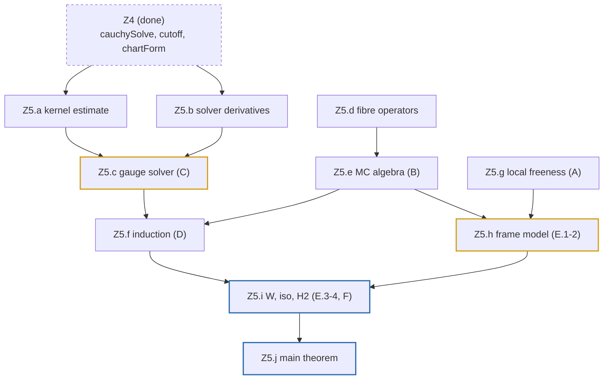

# Blueprint: proving H2, the local gauge lemma (field LL)

*As of 2026-11-01. Proposed item Z5 (phase 7); needs approval (blueprint.md §11, v1.15 DRAFT).*

## Overview

**Target.** `theorem localGaugeLemma : LocalGaugeLemma E X` (`Cohesivemodules/Hypotheses.lean`,
FROZEN), for every complex manifold `X` modelled on a finite-dimensional `E`. The statement:
for every cohesive module `M` over `A = 𝒜_X(X)` and `x ∈ X`, there are an open `U′ ∋ x`, a bounded
complex `W` of finitely generated projective `O_X(U′)`-modules, and an isomorphism in
`Ho(P_{𝒜_X(U′)})` between `M|U′ = M.baseChange (dolbeaultRes E le_top)` and
`𝒜_X(U′) ⊗_{O(U′)} W = CohesiveModule.fromComplex (ρ := dolbeaultRhoU E U′) W …`.

**What we prove.** We prove the strong form, an actual isomorphism of cohesive modules with `W`
free, as in Block's proof and in Bismut–Shen–Wei, Thm 5.3. Near `x`, in a chart and a frame, the
cohesive operator is `𝕏 = ∂̄ + 𝒜`. Here `𝒜` is a smooth function with values in fibre operators,
and flatness is the Maurer–Cartan equation `Σⱼ εⱼ ∂ⱼ𝒜 + 𝒜² = 0`. A gauge transformation, built one
variable at a time following Donaldson–Kronheimer §2.2.2, makes `𝒜` free of forms and holomorphic.
What remains is a complex of trivial holomorphic bundles, `W = (O^r, A₀)`.

**Five layers.**
1. *Analytic core (C).* The one-variable gauge equation `∂̄_k g = g·a` with parameters, solved in a
   finite-dimensional Banach algebra by an elementary Neumann series. It reuses the Z4 Cauchy
   transform.
2. *Operator model (B).* Flat ∂̄-superconnections on an open subset of `E`, the gauge action, and
   the algebraic identities. All of this is pointwise algebra in `FibOp E r` together with
   derivative rules.
3. *Induction (D).* Removing `dz̄₁, …, dz̄ₙ` one at a time.
4. *Local freeness and frames (A, E).* The generator modules of `M|U′` are free near `x`, and the
   frame model connects `M|U′` to layer B.
5. *Assembly (F).* `W`, the isomorphism in `HoP`, and `localGaugeLemma`.

**Simplifications that drive the design.**
- The gauge equation is *linear* (`∂̄_k g = g a`), so no nonlinear fixed-point theory is needed.
- With the operator formulation, holomorphy after each step follows by contracting the
  Maurer–Cartan equation with `ι_i`. Block's p-degree separation argument is not needed (§1, B.4).
- Smoothness comes from summable bounds on all derivatives of the Neumann series terms
  (`contDiff_tsum`, in Mathlib). There is no Hölder or Sobolev space and no elliptic regularity;
  this closes the smoothness gap that all sources leave (§1, a5).
- The global cutoff of Z4.e keeps every function globally defined. The slab property preserves
  holomorphy in the earlier variables.

## 1. Sources and audit

**Sources.**
- **[B] Block**, arXiv math/0509284v2, proof of Lemma 4.1.5 (`references/arXiv-math0509284v2`,
  l. 1034–1083; the published version numbers it Lemma 4.5). This is the only source argument;
  [A, §7.4] ("Assumption 7 follows by [Blo09, Lemma 4.1.5]") and
  [CHL, §7.3] ("Condition (*) is exactly the content of [Block10, Lemma 4.1.5]") cite it.
- **[DK] Donaldson–Kronheimer**, *The geometry of four-manifolds*, §2.2.2, pp. 50–53
  (`references/…4-manifolds.pdf`, PDF pp. 63–66). They prove the integrability theorem 2.1.53, the
  matrix case of our statement, with an L^∞ contraction for the Cauchy kernel (2.2.7)–(2.2.8),
  elliptic regularity for smoothness, and "the standard addendum to the implicit function theorem"
  for parameters. The induction on variables is on p. 52.
- **[BSW] Bismut–Shen–Wei**, *Coherent sheaves, superconnections and RRG*, arXiv 2102.08129
  (Progress in Math 347, 2023), §5.2, Theorem 5.3 (book 5.2.1). "There is an open neighborhood U of
  x, a holomorphic structure ∇^{D|U''} on D|U such that ∇^{D|U''}v0 = 0, and moreover
  (E, A^{E''})|U ≃ (Λ(T̄*U)⊗̂D|U, v0 + ∇^{D|U''})". The gauges are total-degree-0 sections of
  `Aut⁰(Λ(C̄ⁿ)⊗̂End(D))`; the one-variable step is a Neumann series `g = −(1+F)⁻¹F1` in bounded
  continuous functions. Smoothness: "obviously smooth in all variables" (no proof).
- **[DP] Delzant–Py**, arXiv 1012.1585, §6, Prop. 16. The parametrised one-variable lemma for
  Banach-algebra-valued maps, proved with a Hölder contraction (Vekua estimates) and the implicit
  function theorem.
- **[BR] Bondal–Rosly**, arXiv 2211.11112, Local Lemma 3.9. An alternative strict-gauge reduction;
  it uses Koszul–Malgrange as a black box.
- **[Y] Shilin Yu**, arXiv 1206.5155, Thm 2.14 (DK sketch, "details left to the reader").
- No formalization of Koszul–Malgrange, Newlander–Nirenberg or Block's lemma exists. Lean-eval
  lists Newlander–Nirenberg as unsolved; TauCeti plans Koszul–Malgrange via Newlander–Nirenberg
  (Webster), with nothing on superconnections.

**Audit of Block's proof.**

| # | Block's step | Finding | Resolution here |
| --- | --- | --- | --- |
| a1 | "we may assume we are in a polydisc", `E^p` trivial | Assumed, not proved. Needs local triviality of the smooth bundles `E^p` (projective `A⁰(X)`-modules), and a chart. | A: local freeness via the idempotent/rank argument; work inside `chartAt x`. |
| a2 | `𝔼 = 𝔼⁰ + ∂̄ + J`, J `A`-linear with stated bidegrees | Correct in a frame. Only total degree +1 and Λ-linearity are used. | B: `𝒜` odd, Λ-linear, degree 1. |
| a3 | Solve `φ₁⁻¹∂̄₁φ₁ = J′ ∧ dz̄₁` | The equation is linear (`∂̄₁ g = g a`), but `J′` has components of all form degrees in `dz̄_{≥2}`. The gauge must be a total-degree-0 element of `End(E) ⊗̂ Λ`; [DK] treats only matrices. | C in any finite-dim Banach algebra, with values in a closed subalgebra (BSW, DP do the same). |
| a4 | Holomorphy of `𝔼₁⁰`, `J₁` in `z₁` via "each summand individually zero" (p-degree separation) | The argument is plausible, but cross terms with `∂̄_{≥2}` are not checked. | Not needed: contracting MC with `ι_i` gives `∂_i𝒜 = 0` directly (B.4). |
| a5 | "possibly having to shrink the polydisc"; "so will φ₂" (smooth in parameters, holomorphic in `z₁`) | Smooth and holomorphic dependence on parameters is only asserted (also in [BSW]: "obviously smooth"; [DK]: IFT addendum; [DP]: Hölder + IFT). | C.3–C.8: derivative-wise Neumann bounds and `contDiff_tsum`; holomorphy termwise. |
| a6 | Cutoff (in [DK], [BSW]) | A cutoff in `C_c^∞(ℂⁿ)` destroys holomorphy in `z_{<k}` ([BSW]'s cutoff has this issue). | Slab cutoff of Z4.e (`exists_cutoff`), constant in the `e_j`-directions, `j ≠ k`, on a slab stable under `z ↦ z − t e_k`. |
| a7 | End: `𝔽 = 𝔼ₙ⁰ + ∂̄`, then "Stein … coherent" | For the weak H2 only the gauge form is needed; coherence is not. | E: `W = (O^r, A₀)` free, and an actual isomorphism. |
| a8 | Conventions | Block uses right modules and `c_Block = −c` (conventions §3). | Our left-module encoding throughout; signs are fixed once in B. |

Verdict: the strategy is sound and complete apart from a1, a3 and a5, which are
infrastructure and analysis. No step is false.

**Routes considered.**
- **Chosen:** Block/DK/BSW gauge induction in operator form.
- Bondal–Rosly: Koszul–Malgrange stays a black box, so no saving.
- Homological route via A11/A12: it still needs holomorphic frames.
- Newlander–Nirenberg first, as in TauCeti's plan: much harder.
- Delzant–Py Hölder route: needs function-space infrastructure Mathlib lacks; you chose the
  elementary series on 1 Nov 2026.

## 2. Existing infrastructure

**Project (verified).**
- Z4.b `cauchyTransform`, `dbar_cauchyTransform`.
- Z4.c `cauchySolve v F z = π⁻¹ ∫ t⁻¹ • F (z − t • v)`, `contDiff_cauchySolve`,
  `hasFDerivAt_cauchySolve`, `map_cauchySolve` (ℂ-linear CLMs), `integrable_cauchySolve`,
  `dbar_cauchySolve` (`½(D v + i D(iv)) = F`), `exists_clm_apply_eq_one`.
- Z4.e `exists_cutoff` (slab cutoff), `contDiff_cutoff_smul`, `conjBasis`; private helpers
  `cauchySolve_eq_zero` (solver vanishes on a stable slab), `fderiv_cutoff_smul`,
  `fderiv_cutoff_smul_of_notMem` (to be made public).
- Z4.d `ctr`, `ctr_ctr_comm`, `eq_zero_of_ctr_basis`.
- Z4.f `chartOpen`, `chartForm`, `chartExpr_chartForm`, `isDolbeault_chartForm`,
  `eq_of_chartExpr_eq`, `chartExpr_dbarSec_chartForm`.
- F9 `chartExpr_mul`, `chartExpr_dbarSec_eq`, `IsDolbeault.contDiffAt_chartExpr`.
- F12 `exists_dolbeaultRhoU_of_dbar_eq_zero`, `dolbeaultRhoU_injective`, `dbar_dolbeaultRhoU`.
- Cohesive-module side (Explore inventory, 1 Nov 2026):
  - A10 `fcExt`, `fcResP_fcExt`, `fc_hom_ext`, `fc_extend_fcι`, `fcι`, `FCGen`.
  - A9 `BCGen`, `bcF`, `bcθp_tmul`, `bcLift`, `bcLift_mem_Z0`, `famTot`, `famTot_mem`,
    `bcCompIso`.
  - A4.c `homEquivGen`, `hom_tmul`.
  - The `HoP` isomorphism template in `Algebra/DegreeZero.lean:166–252`
    (`exists_iso_fromComplex_of_degree_zero`: `fcExt` one way, `famTot` the other, both
    composites identity, `Submodule.Quotient.mk`).
- Gaps:
  - `Module.Free` occurs nowhere; there is no local-freeness lemma.
  - There is no API for isomorphisms in `HoP` (built inline as in `DegreeZero`).
  - Nothing turns a quasi-isomorphism into an isomorphism in `HoP`; this blueprint does not
    need it.

**Mathlib (verified at v4.35.0).**
- Series: `contDiff_tsum`, `iteratedFDeriv_tsum`, `fderiv_tsum` (`Analysis/Calculus/SmoothSeries`).
- Bounds: `norm_iteratedFDeriv_mul_le` (`ContDiff/Bounds`),
  `summable_pow_mul_geometric_of_norm_lt_one`, `Units.oneSub` (`SpecificLimits/Normed`),
  `ContinuousLinearMap.map_tsum`, `tsum_mul_right`.
- Integration: `Complex.integral_comp_polarCoord_symm`, `locallyIntegrable_of_norm_le_rpow`
  (used in Z4.a).
- Instances found by `inferInstance` for `FibOp E r := (Fin r → TotFibre E) →L[ℂ] _`:
  `NormedRing`, `NormedAlgebra ℂ`, `CompleteSpace`, `FiniteDimensional ℂ` (prototype P12).

## 3. Design decisions

- **L1. Operator model.**
  - Fibre `Fib E r := Fin r → TotFibre E`, i.e. `Λ ⊗ F` with `F = ℂ^r` and generator degrees
    `deg : Fin r → ℤ`.
  - Fibre operators `FibOp E r := Fib E r →L[ℂ] Fib E r`, a finite-dimensional complex Banach
    algebra with `‖1‖ = 1`.
  - Superconnection coefficient `𝒜 : E → FibOp E r`; gauges `g : E → FibOp E r`.
  - All sign bookkeeping lives in two fibre operators: `εⱼ` (left multiplication by `dz̄ⱼ`) and
    `ιⱼ` (contraction with the j-th basis vector of `Ē`). No matrices of forms with twisted
    products.
- **L2. Flatness is the MC equation.** `mcOp 𝒜 := Σⱼ εⱼ ∂ⱼ𝒜 + 𝒜²`, with
  `∂ⱼ := pdbar (finBasis j)`. It is derived once from `𝕏² = 0` (B.2).
- **L3. `pdbar v f z := ½ (Df(z) v + i Df(z)(i v))`** for any normed-space-valued `f`. It matches
  Z4.c's raw form and `dbarPart f z (toConj v)` for form-valued `f`.
- **L4. Solver = Neumann series** `g = Σ_i u_i`, `u₀ = 1`, `u_{i+1} = T(u_i · b)`,
  `T = cauchySolve e_k`, `b = ψ a`. A sup-norm contraction gives invertibility; derivative bounds
  give smoothness via `contDiff_tsum`. You chose this on 1 Nov 2026.
- **L5. Constraints as a subalgebra.** "Total degree 0, Λ-linear, no `dz̄_{≤k}` components" is the
  commutant of `{εⱼ}_j ∪ {ιᵢ}_{i ≤ k}` intersected with the degree-0 operators. This is a
  (closed, finite-dimensional) subalgebra `S`, and the solver preserves it (C.6).
- **L6. Strong form.** Build an actual isomorphism `Φ : fromComplex W ≅ M|U″` with `W` free,
  from explicit mutually inverse closed maps (the `DegreeZero` template).
- **L7. Charts.** Everything happens in `φ = chartAt x` on `V = φ(U′)`, and is transported with
  Z4.f (`chartExpr`/`chartForm`). This is not the full F13.

## 4. Mathematical proof

Notation: `n = dim_ℂ E`; `e = finBasis ℂ E`; `b_j = conjBasis E j = toConj e_j`; `∂_j = pdbar e_j`.
All functions are on open subsets of `E`.

### A. Local freeness
- **A.1** A f.g. projective module `P` over `R = A⁰(X)` (degree-0 Dolbeault forms, i.e. smooth
  ℂ-valued functions) is the image of an idempotent `ε ∈ M_N(R)`.
- **A.2** `y ↦ ε(y) ∈ M_N(ℂ)` is continuous and idempotent, so `rank ε(y) = tr ε(y)` is locally
  constant, equal to `r` near `x`. Choose `c₁…c_r ∈ ℂ^N` with `ε(x)cᵢ` a basis of `im ε(x)`, and
  an `r × r` minor `μ(y)` of `[ε(y)c₁ … ε(y)c_r]` with `det μ(x) ≠ 0`. On an open `U′ ∋ x`,
  `det μ ≠ 0` and `rank ε = r`.
- **A.3** On `U′` the sections `σᵢ = ε cᵢ` form a basis of `A⁰(U′) ⊗_R P`:
  - they span, because `s = εs` gives `s(y) = Σ fᵢ(y) ε(y)cᵢ` with `f = μ⁻¹ ·` (the rows of `s`),
    which is smooth since `det μ ≠ 0` (Cramer; inverses of nonvanishing degree-0 forms are
    Dolbeault forms);
  - they are independent pointwise.

  Shrink `U′` into `(chartAt x).source`. This gives `exists_free_baseChange`.
- **As built (blueprint §11 v1.17, recorded here by v1.18).** A.1–A.3 are replaced by
  localization (no idempotents, minors or Cramer): `m := ker (ev_x : A⁰(X) → ℂ)` is prime; each
  `Q^p` has a free localization at some `r_p ∉ m`
  (`Module.FinitePresentation.exists_free_localizedModule_powers`); on
  `U′ := (chartAt x).source ∩ {r_p ≠ 0 for a ≤ p ≤ b}` the `r_p` are units, so
  `A⁰(U′) ⊗ Q^p` is free. Statement of `exists_free_baseChange` unchanged (`Forms/LocalFree.lean`).

### B. Flat ∂̄-superconnections (operator model)
- **B.0 Fibre operators.**
  - `εⱼ`: left multiplication by `dz̄ⱼ` in each component.
  - `ιⱼ`: contraction with `b_j` in each component (degreewise `ctr`, zero on degree 0).
  - Relations: `εᵢεⱼ = −εⱼεᵢ`, `ιᵢιⱼ = −ιⱼιᵢ`, `ιᵢεⱼ + εⱼιᵢ = δᵢⱼ` (`dz̄ᵢ(b_j) = δᵢⱼ`).
  - An operator is *Λ-linear of parity σ* if `T εⱼ = (−1)^σ εⱼ T` for all `j`; `Λ` is generated
    by the `dz̄ⱼ`, so this means Λ-linear in the graded sense.
  - `IsOfTotDeg deg d T`: `T` maps total degree `m` to `m + d`, where `t_i ∈ Λ^q` has total
    degree `q + deg i`.
  - Kernel lemma: a vector killed by every `ιⱼ` lies in form degree 0 (A5 of Z4.d,
    `eq_zero_of_ctr_basis`).
- **B.1 Coordinate formula.** For a section `s : V → Fib`, `∂̄s = Σⱼ εⱼ ∂ⱼ s`, componentwise
  `dbarTot`. Proof: on `Ē`, `antiPart L v = Σⱼ b_j^*(v) antiPart L (b_j)`, and
  `alternatizeUncurryFin (Σⱼ b_j^* ⊗ cⱼ) = Σⱼ dz̄ⱼ ∧ cⱼ` (F6 wedge).
- **B.2 Curvature.** If `𝒜` is odd and Λ-linear, then
  `(∂̄ + 𝒜)² s = mcOp 𝒜 · s` with `mcOp 𝒜 = Σⱼ εⱼ ∂ⱼ𝒜 + 𝒜²`. This uses `∂̄² = 0` (F4), the
  product rule `∂ⱼ(𝒜 s) = (∂ⱼ𝒜)s + 𝒜 ∂ⱼ s`, and `𝒜εⱼ = −εⱼ𝒜`. Applied to constant sections,
  `𝕏² = 0 ⇔ mcOp 𝒜 = 0`.
- **B.3 Gauge action.** For `g` smooth, pointwise invertible, even, Λ-linear and of degree 0,
  `g ∘ (∂̄ + 𝒜) ∘ g⁻¹ = ∂̄ + g·𝒜`, where `g·𝒜 := g𝒜g⁻¹ − (Σⱼ εⱼ ∂ⱼg) g⁻¹` (use
  `g ∂ⱼ(g⁻¹) = −(∂ⱼg)g⁻¹`).
  - `g·𝒜` is again odd, Λ-linear and of degree 1.
  - `mcOp (g·𝒜) = g (mcOp 𝒜) g⁻¹`.
  - `(hg)·𝒜 = h·(g·𝒜)`.
- **B.4 Contracted MC.** With `aᵢ := ιᵢ𝒜 + 𝒜ιᵢ` (even, degree 0):
  `ιᵢ mcOp 𝒜 − mcOp 𝒜 ιᵢ = ∂ᵢ𝒜 − Σⱼ εⱼ ∂ⱼaᵢ + aᵢ𝒜 − 𝒜aᵢ`.
  - Check: `[ιᵢ, εⱼ∂ⱼ𝒜] = δᵢⱼ∂ⱼ𝒜 − εⱼ∂ⱼaᵢ` and `[ιᵢ, 𝒜²] = aᵢ𝒜 − 𝒜aᵢ`.
  - Corollary: if `mcOp 𝒜 = 0` and `aᵢ ≡ 0` on an open set, then `∂ᵢ𝒜 = 0` there.
- **B.5 The step algebra.** Suppose `g` (as in B.3) commutes with `ιᵢ` for `i ∈ I ∪ {k}`, satisfies
  `∂ᵢg = 0` for `i ∈ I`, and `∂_k g = g a_k`. Then the coefficients of `𝒜′ = g·𝒜` are
  `a′ᵢ = g aᵢ g⁻¹ − (∂ᵢg)g⁻¹`; so `a′ᵢ = g aᵢ g⁻¹` for `i ∈ I`, and `a′_k = 0`.
- **B.6 Properties of `a_k`.** If `aᵢ ≡ 0` on `U` for `i < k`, then on `U`:
  - `a_k` is even, Λ-linear (`[εⱼ, a_k] = 0`) and of degree 0;
  - `[ιᵢ, a_k] = 0` for `i ≤ k` (super Jacobi; `ι_k² = 0`);
  - `∂ᵢ a_k = [ι_k, ∂ᵢ𝒜]₊ = 0` for `i < k` (B.4).
- **B.7 End of the induction.** If `aᵢ ≡ 0` for all `i`, then `𝒜(1 ⊗ f) ∈ Λ⁰ ⊗ F` (kernel lemma)
  and `𝒜(ω·s) = (−1)^{|ω|} ω·𝒜(s)`. So `𝒜 = σ ⊗ A₀` with `A₀ : F → F` of degree +1. By B.4,
  `∂ᵢA₀ = 0` for all `i`, so `A₀` is holomorphic; MC then gives `A₀² = 0`.

### C. One-variable gauge solver (`exists_gauge_solution`)
Given:
- `𝔄` a finite-dimensional complex Banach algebra with `‖1‖ = 1` (here `FibOp E r`), and `S` a
  subalgebra;
- `U ∋ x` open, a direction index `k`, and `J ∌ k`;
- `a ∈ C^∞(U, 𝔄)` with `a(U) ⊆ S` and `∂ⱼ a = 0` on `U` for `j ∈ J`.

Find `W ∋ x` and `g ∈ C^∞(E, 𝔄)` with `g(E) ⊆ S`, `g(z)` invertible for all `z`,
`∂_k g = g a` on `W`, and `∂ⱼ g = 0` on `W` for `j ∈ J`.

- **C.0 Cutoff with radius control.** This is a variant of Z4.e `exists_cutoff` exposing its
  construction `ψ(z) = χ₁(c_k(z−x))·χ₂(P(z−x))`. Fix a compact neighbourhood `K ⊆ U` of `x` and
  `M_K = sup_K ‖a‖`. For every small `r > 0` there is `ψ` with:
  - `0 ≤ ψ ≤ 1` and `tsupport ψ ⊆ K ∩ {|c_k(w−x)| ≤ 2r}`;
  - `ψ = 1` on an open `W ∋ x`;
  - the slab `S_r ⊇ W` is stable under `z ↦ z − t e_k`, and `∂ⱼψ = 0` on it for `j ≠ k`.

  Put `b := ψ·a` (extended by 0): `b ∈ C_c^∞`, `‖b‖_∞ ≤ M_K`.
- **C.1 Kernel estimate.** If `G(w) ≠ 0 ⇒ |ℓ(w) − c| ≤ ρ` with `ℓ(e_k) = 1`, then
  `‖T G‖_∞ ≤ 3ρ ‖G‖_∞`. Indeed `∫_{B(c′,ρ)} |t|⁻¹ dA ≤ ∫_{B(0,ρ)} |t|⁻¹ dA + πρ²/ρ = 3πρ`, by
  polar coordinates for the first term.
- **C.2 Derivatives.** For `F ∈ C_c^∞`, `D^m(T F) = T(D^m F)` (iterate `hasFDerivAt_cauchySolve`;
  the solver for multilinear-map-valued `F` elaborates, P12). Also
  `∂_k (T F) = F` (`dbar_cauchySolve`) and `∂ⱼ(T F) = T(∂ⱼ F)` (C3 of Z4.e, for `𝔄`-valued `F`).
- **C.3 Bounds.** Let `u₀ = 1` and `u_{i+1} = T(u_i b)`; each `u_i` is `C^∞` with bounded
  derivatives (C.2, C.1).
  - Notation: `θ = 6r M_K`, `β_l = sup ‖D^l b‖`, `M_m(i) = sup ‖D^m u_i‖`.
  - Recursion (Leibniz, `norm_iteratedFDeriv_mul_le`):
    `M_m(i+1) ≤ 6r Σ_{l≤m} C(m,l) β_{m−l} M_l(i) ≤ θ M_m(i) + B_m (i+1)^{m−1} θ^i`.
  - Hence `M_m(i) ≤ C_m (i+1)^m θ^i`. Choose `r` with `θ < 1/2` first; the `β_l` for `l ≥ 1`
    may then be large but are fixed. Only `β₀ ≤ M_K` enters `θ`.
- **C.4 Smoothness.** `g := Σ_i u_i` is `C^∞` by `contDiff_tsum` with `v m i = C_m (i+1)^m θ^i`
  (`summable_pow_mul_geometric_of_norm_lt_one`).
- **C.5 Equation.** `∂_k g = Σ_i ∂_k u_i = Σ_i u_i b = g b` (`fderiv_tsum`, C.2,
  `tsum_mul_right`). On `W` (where `ψ = 1`), `∂_k g = g a`.
- **C.6 Subalgebra.** Let `Q : 𝔄 → 𝔄/S` be the quotient map (a CLM, finite dimension).
  `Q(T F) = T(Q∘F)` (`map_cauchySolve`), so `u_i ∈ S` by induction, and
  `Q(g) = Σ Q(u_i) = 0` (`ContinuousLinearMap.map_tsum`).
- **C.7 Invertibility.** `‖g(z) − 1‖ ≤ Σ_{i≥1} θ^i < 1`, so `g(z)` is a unit (`Units.oneSub`).
- **C.8 Holomorphy.** For `j ∈ J`: on `S_r`, `∂ⱼ b = (∂ⱼψ)a + ψ∂ⱼa = 0` (off `U`, `b ≡ 0` near the
  point). By induction `∂ⱼ u_i = 0` on `S_r`: `∂ⱼ u_{i+1} = T(∂ⱼu_i·b + u_i·∂ⱼb)`, the argument
  vanishes on `S_r`, and the lines `z − t e_k` stay in `S_r` (`cauchySolve_eq_zero`). Then
  `∂ⱼg = Σ ∂ⱼu_i = 0` on `S_r ⊇ W`.

### D. Induction (`exists_gauge_holomorphic`)
- **Claim P(k), `k = n, n−1, …, 0`.** For every open `U ∋ x` and every `𝒜` on `U` that is smooth,
  odd, Λ-linear, of degree 1 and MC, with `aᵢ ≡ 0` on `U` for `i < k`, there are `W ∋ x` and a
  gauge `g` (smooth, invertible, even, Λ-linear, degree 0) such that, on `W`,
  `g·𝒜 = σ ⊗ A₀` with `A₀` holomorphic and `A₀² = 0`.
- **P(n):** take `g = 1` and B.7.
- **P(k) from P(k+1):** apply C with:
  - `a := a_k`;
  - `S := {T | degree 0, [εⱼ,T] = 0 ∀j, [ιᵢ,T] = 0 ∀ i ≤ k}`;
  - `J := {i < k}`.

  The hypotheses hold by B.6. C gives `W₁, g₁`. Then `𝒜₁ := g₁·𝒜` satisfies the hypotheses of
  P(k+1) on `W₁` (B.3, B.5). P(k+1) gives `W₂, g₂`; take `g := g₂g₁` (B.3 composition).
- `exists_gauge_holomorphic` is P(0).

### E. Frames, the complex `W`, the isomorphism
- **E.1 Frames.** On `U′ ⊆ chart source` with free generators (A), fix the frame `ẽᵢ` (degree
  `deg i`). Then `Tot(M|U′) = ⊕ᵢ DolbeaultAlg(U′) ẽᵢ` and
  `θ(ẽᵢ) = Σⱼ ωⱼᵢ ⊗ ẽⱼ` with `ωⱼᵢ` of degree `deg i + 1 − deg j`.
- **E.2 Flat transport.**
  - On `V = φ(U′)`, the chart expression of a section is `z ↦ (chartExpr sᵢ (z))ᵢ ∈ Fib`.
  - `𝒜(z)(t)_j := Σᵢ σ(tᵢ)·chartExpr ωⱼᵢ(z)`, where `σ` is the degree sign on `TotFibre` and the
    product is in `TotFibre`.
  - Then `chartExpr(𝕏 s) = ∂̄(chartExpr s) + 𝒜·chartExpr s` (`chartExpr_dbarSec_eq`,
    `chartExpr_mul`, B.1).
  - `𝒜` is smooth (F9.a), odd, Λ-linear and of degree 1; MC follows from `𝕏² = 0` via B.2,
    because every smooth `V → Fib` is the chart expression of a section (`chartForm`, Z4.f).
  - *As built (v1.18 record):* MC is proved from `𝕏² = 0` on the frame vectors only, plus
    Λ-linearity of `mcOp`: `mcOp` is Λ-linear and even, so vanishing on the `r` constant
    generators of `Λ ⊗ ℂ^r` gives `mcOp = 0`. Same statement (`isFlatSuperconn_frameOp`,
    `Forms/FrameModel.lean`); `chartForm` on all sections is not needed.
- **E.3 The complex `W`.**
  - By D, on `W₀ ∋ φ x`: `g·𝒜 = σ ⊗ A₀`.
  - Let `U″ := chartOpen x W₀`. The entries of `A₀` are holomorphic on `W₀`; their `chartForm`s
    are ∂̄-closed degree-0 forms on `U″`, hence `ρ(fᵢⱼ)` for holomorphic `fᵢⱼ ∈ O(U″)` (F12).
  - Set `W^p := O(U″)^{#{i : deg i = p}}` with differential `(fᵢⱼ)`. Then `d² = 0`
    (`ρ` injective, `A₀² = 0`), and `W` is bounded, f.g. and free (`IsBoundedFGProj`).
  - *As built (v1.18 record):* this `ρ`-preimage construction is the one used (first option of
    the open question in §7; `exists_hol_of_chartExpr`, `matComplex`, `Forms/LocalGauge.lean`).
- **E.4 The isomorphism.** Let `G` be the `chartForm` transport of `g` (coefficients on `U″`).
  - `Φ : fromComplex W → M|U″` via `fcExt`: `Φ(fcι wᵢ) = Σⱼ (G⁻¹)ⱼᵢ ⊗ ẽⱼ`. It is closed
    because `𝕏 G⁻¹ = G⁻¹(∂̄ + σ⊗A₀)` on generators, which is B.3 transported.
  - `Ψ : M|U″ → fromComplex W` on generators: `ẽⱼ ↦ Σᵢ Gᵢⱼ ⊗ fcι wᵢ` (`homEquivGen` /
    `famTot`-style extension).
  - `Ψ∘Φ = id` and `Φ∘Ψ = id` on generators, from `GG⁻¹ = 1` (`fc_hom_ext`, `hom_ext` on
    generators).
  - The iso in `HoP` is built by the `DegreeZero` template. Base change from `X` to `U″` goes
    through `U′` (`bcCompIso`) or directly, freeness restricting along `U″ ≤ U′`.

### F. Assembly
`localGaugeLemma`: `intro M x`, then
1. A gives `U′`, frames;
2. E.1–E.2 give `𝒜` on `V`;
3. D gives `W₀`, `g`;
4. E.3–E.4 give `W` and the iso.

The statement is exactly the frozen `LocalGaugeLemma E X` (`U′ := U″`).

## 5. Lean blueprint

All signatures below elaborate (P12, `Scratch/P12_LL.lean`, 1 Nov 2026: 9 declarations, only
`sorry` warnings). `epsOp`, `iotaOp` and `IsOfTotDeg` had placeholder bodies there and get real
definitions in Z5.d.

```lean
-- Z5.b
def pdbar {Λ : Type} [NormedAddCommGroup Λ] [NormedSpace ℂ Λ] (v : E) (f : E → Λ) (z : E) : Λ :=
  (2 : ℂ)⁻¹ • (fderiv ℝ f z v + I • fderiv ℝ f z (I • v))
-- Z5.a
theorem norm_cauchySolve_le {v : E} (ℓ : E →L[ℂ] ℂ) (hℓ : ℓ v = 1) {G : E → Λ} {c : ℂ}
    {ρ C : ℝ} (hρ : 0 ≤ ρ) (hsupp : ∀ w, G w ≠ 0 → ‖ℓ w - c‖ ≤ ρ) (hG : ∀ w, ‖G w‖ ≤ C)
    (z : E) : ‖cauchySolve v G z‖ ≤ 3 * ρ * C
-- Z5.b
theorem iteratedFDeriv_cauchySolve {v : E} (hv : v ≠ 0) {F : E → Λ} (hF : ContDiff ℝ ∞ F)
    (hc : HasCompactSupport F) (m : ℕ) (z : E) :
    iteratedFDeriv ℝ m (cauchySolve v F) z = cauchySolve v (iteratedFDeriv ℝ m F) z
-- Z5.c   [NormedRing 𝔄] [NormedAlgebra ℂ 𝔄] [CompleteSpace 𝔄] [NormOneClass 𝔄]
--        [FiniteDimensional ℂ 𝔄]
theorem exists_gauge_solution (k : Fin (Module.finrank ℂ E)) {U : Set E} (hU : IsOpen U)
    {x : E} (hx : x ∈ U) (a : E → 𝔄) (ha : ContDiffOn ℝ ∞ a U) (S : Subalgebra ℂ 𝔄)
    (haS : ∀ z ∈ U, a z ∈ S) (J : Finset (Fin (Module.finrank ℂ E))) (hkJ : k ∉ J)
    (haJ : ∀ j ∈ J, ∀ z ∈ U, pdbar (Module.finBasis ℂ E j) a z = 0) :
    ∃ W : Set E, IsOpen W ∧ x ∈ W ∧ W ⊆ U ∧ ∃ g : E → 𝔄, ContDiff ℝ ∞ g ∧
      (∀ z, g z ∈ S) ∧ (∀ z, IsUnit (g z)) ∧
      (∀ z ∈ W, pdbar (Module.finBasis ℂ E k) g z = g z * a z) ∧
      (∀ j ∈ J, ∀ z ∈ W, pdbar (Module.finBasis ℂ E j) g z = 0)
-- Z5.d
abbrev Fib (r : ℕ) : Type := Fin r → TotFibre E
abbrev FibOp (r : ℕ) : Type := Fib E r →L[ℂ] Fib E r
def epsOp (j : Fin (Module.finrank ℂ E)) : FibOp E r      -- dz̄_j ∧ ·
def iotaOp (j : Fin (Module.finrank ℂ E)) : FibOp E r     -- ι_{b_j}
def IsOfTotDeg (deg : Fin r → ℤ) (d : ℤ) (T : FibOp E r) : Prop
-- Z5.e
def mcOp (𝒜 : E → FibOp E r) (z : E) : FibOp E r :=
  (∑ j, epsOp j * pdbar (Module.finBasis ℂ E j) 𝒜 z) + 𝒜 z * 𝒜 z
def gaugeOp (g 𝒜 : E → FibOp E r) (z : E) : FibOp E r :=
  g z * 𝒜 z * Ring.inverse (g z) -
    (∑ j, epsOp j * pdbar (Module.finBasis ℂ E j) g z) * Ring.inverse (g z)
-- Z5.f
theorem exists_gauge_holomorphic (deg : Fin r → ℤ) {U : Set E} (hU : IsOpen U) {x : E}
    (hx : x ∈ U) (𝒜 : E → FibOp E r) (h𝒜 : ContDiffOn ℝ ∞ 𝒜 U)
    (hdeg : ∀ z ∈ U, IsOfTotDeg deg 1 (𝒜 z))
    (hodd : ∀ z ∈ U, ∀ j, epsOp j * 𝒜 z = -(𝒜 z * epsOp j))
    (hmc : ∀ z ∈ U, mcOp 𝒜 z = 0) :
    ∃ W : Set E, IsOpen W ∧ x ∈ W ∧ W ⊆ U ∧ ∃ g : E → FibOp E r, ContDiff ℝ ∞ g ∧
      (∀ z, IsUnit (g z)) ∧ (∀ z, IsOfTotDeg deg 0 (g z)) ∧
      (∀ z j, epsOp j * g z = g z * epsOp j) ∧
      ∀ z ∈ W, (∀ j, iotaOp j * gaugeOp g 𝒜 z = -(gaugeOp g 𝒜 z * iotaOp j)) ∧
        ∀ j, pdbar (Module.finBasis ℂ E j) (gaugeOp g 𝒜) z = 0
-- Z5.g
theorem exists_free_baseChange (M : CohesiveModule (dolbeault E X)) (x : X) :
    ∃ U' : Opens X, x ∈ U' ∧ (U' : Set X) ⊆ (chartAt E x).source ∧
      ∀ p, Module.Free ↥(dolbeaultGrade E U' 0)
        (BCGen (dolbeaultRes E (le_top : U' ≤ ⊤)) M.Q p)
-- Z5.i
theorem localGaugeLemma : LocalGaugeLemma E X
```
The conclusion of `exists_gauge_holomorphic` (anticommutes with every `ιⱼ`, holomorphic) is
turned into `σ ⊗ A₀` by B.7 in Z5.e (`eq_sigma_tensor_of_iota`, to be stated with the real
`epsOp`/`iotaOp`).

**Items and files (new files only; no FROZEN file changes).**

| Item | File | Content | Est. lines |
| --- | --- | --- | --- |
| Z5.a | `Analysis/KernelEstimate.lean` | `∫_{B(c,ρ)} \|t\|⁻¹ ≤ 3πρ` (polar coordinates), `norm_cauchySolve_le` | 150–250 |
| Z5.b | `Analysis/CauchySolveDeriv.lean` | `pdbar` (+ link to `dbarPart`), `iteratedFDeriv_cauchySolve`, `pdbar_cauchySolve`, `pdbar_cauchySolve_comm` for any normed codomain; make Z4.e's `cauchySolve_eq_zero`, `fderiv_cutoff_smul*` public | 250–400 |
| Z5.c | `Analysis/GaugeSolve.lean` | cutoff with radius control (C.0), Neumann bounds (C.3), `exists_gauge_solution` (C.4–C.8) | 500–900 |
| Z5.d | `Forms/FibreOps.lean` | `Fib`, `FibOp`, `epsOp`, `iotaOp`, CAR relations, `IsOfTotDeg`, Λ-linearity, kernel lemma, B.1 coordinate formula | 400–700 |
| Z5.e | `Forms/Superconnection.lean` | `mcOp`, `gaugeOp`, B.2–B.7 | 400–700 |
| Z5.f | `Forms/GaugeInduction.lean` | `exists_gauge_holomorphic` (D) | 200–350 |
| Z5.g | `Forms/LocalFree.lean` | A.1–A.3, `exists_free_baseChange` | 400–700 |
| Z5.h | `Forms/FrameModel.lean` | E.1–E.2 (frame, transported `𝒜`, MC from flatness) | 500–900 |
| Z5.i | `Forms/LocalGauge.lean` | E.3–E.4, F: `W`, `Φ`, `Ψ`, iso in `HoP`, `localGaugeLemma` | 500–900 |
| Z5.j | `MainH2.lean`, `ChecksMain.lean` | Block's theorem with no hypotheses (theorem; a new frozen main statement needs your decision), `#print axioms` | 30–80 |

Total ≈ 3,300–6,000 lines (H1 was ≈ 1,600).

## 6. Milestones


Parallel tracks:
- analysis: Z5.a → Z5.b → Z5.c;
- algebra: Z5.d → Z5.e;
- modules: Z5.g.

These meet in Z5.f/Z5.h. Prototype first (P13): C.1–C.4 on a toy algebra (`𝔄 = ℂ`), the
largest analytic risk.

## 7. Risks and open checks
- **Generator-level signs (Z5.h, Z5.i).** Matching `𝕏(a⊗e) = da⊗e + σ(a)θ(e)` with `∂̄ + 𝒜`, and
  `Φ`/`Ψ` with the `twist` signs of `Hom`. Mitigation: fix the identification once (E.2) with
  `rfl`-level interface lemmas, and test on the n = 0 case (`DegreeZero.lean`).
- **BCGen elaboration (PROGRESS traps).** Base-change types block `rw` and instance search. Work
  at the `BCGen` level with `rfl` lemmas; pass `M₁ :=` explicitly.
- **Local freeness (Z5.g).** It needs degree-0 forms as a ring of smooth functions:
  - inverses of nonvanishing functions are Dolbeault (new small lemma);
  - `Module.Projective` + `Module.Finite` give an idempotent presentation (Mathlib:
    `Module.Projective.exists_comp_eq_id`-type lemmas, to verify).
- **Kernel estimate (Z5.a).** `∫_{B(0,ρ)} |t|⁻¹ = 2πρ` via `Complex.integral_comp_polarCoord_symm`
  restricted to a ball.
- **`iteratedFDeriv_cauchySolve`.** Induction on `m` with the solver applied to multilinear-map
  values. The statement elaborates (P12); the codomain changes with `m` (use
  `iteratedFDeriv_succ_eq_comp_left` and the CLM `continuousMultilinearCurryLeftEquiv`).
- **Open:**
  - the real bodies of `epsOp`/`iotaOp`/`IsOfTotDeg` (Z5.d), and a re-check of the P12
    signatures with them;
  - ~~the exact Mathlib name for the idempotent presentation of projective modules~~ (void:
    localization route, v1.17);
  - ~~whether `W` should be over `O(U″)` via `ρ`-preimages (E.3) or built directly~~ (decided:
    `ρ`-preimages, as built; recorded by v1.18).

## References
- [B] J. Block, arXiv math/0509284v2, Lemma 4.1.5 and its proof.
- [DK] S. Donaldson, P. Kronheimer, *The geometry of four-manifolds*, §2.2.2, pp. 50–53.
- [BSW] J.-M. Bismut, S. Shen, Z. Wei, arXiv 2102.08129, §5.2 Thm 5.3, §5.3 Thm 5.7.
- [DP] T. Delzant, P. Py, arXiv 1012.1585, §6, Prop. 16–17.
- [BR] A. Bondal, A. Rosly, arXiv 2211.11112, Lemma 3.9, 3.12.
- [Y] S. Yu, arXiv 1206.5155, Thm 2.14, Lemma 3.17.
- [A] P. Antweiler, arXiv 2411.19595, §7.4; [CHL] Chuang–Holstein–Lazarev, §7.3.
- Hörmander, *An introduction to complex analysis in several variables*, Thms 1.2.1–1.2.2.
